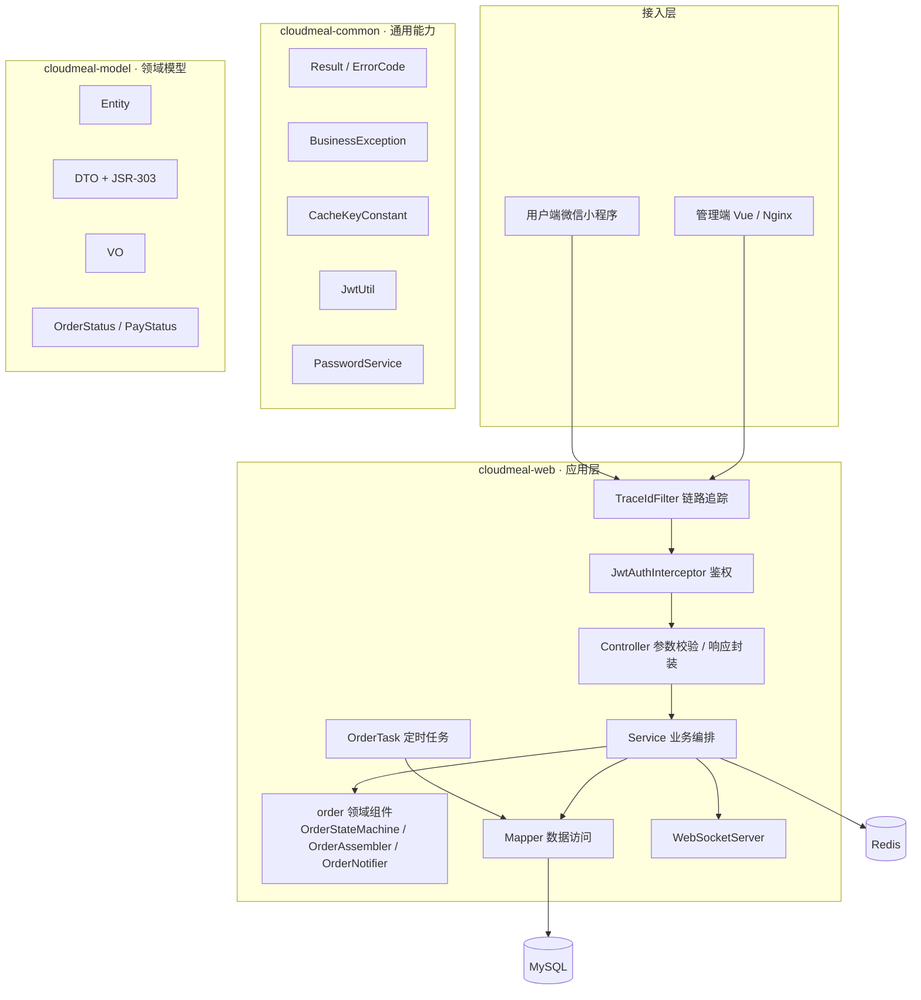

# 云膳外卖 CloudMeal Takeout

面向中小餐饮企业的点餐与经营管理系统。后端提供 **管理端（商家员工）** 与 **用户端（小程序消费者）** 两套 API，
覆盖「菜单管理 → 下单支付 → 商家接单 → 配送 → 经营分析」的完整业务闭环。


---

## 一、项目背景

项目起步于常见的「外卖教学项目」架构，随后围绕**分层清晰度、可测试性与可运维性**做了一次系统性的工程化重构：
把 500 行的订单巨类拆成状态机 / 装配器 / 订单号生成器 / 通知器，把散落的异常类收敛为统一错误码，
补齐参数校验、密码加密升级、缓存一致性、单元测试与容器化部署。（详见文末「重构说明」）

---

## 二、技术栈

| 分类 | 选型 |
| --- | --- |
| 语言 / 构建 | Java 17、Maven 多模块 |
| 框架 | Spring Boot 3.1.2、Spring MVC、MyBatis、PageHelper |
| 存储 | MySQL 8.0、Redis 7、Druid 连接池 |
| 鉴权 | JWT（jjwt 0.12）、BCrypt 密码加密 |
| 实时通信 | WebSocket（商家端来单提醒 / 客户催单） |
| 报表 | Apache POI（营业数据导出 Excel） |
| 接口文档 | SpringDoc + Knife4j |
| 运维 | Docker / Docker Compose、GitHub Actions、Actuator |

---

## 三、模块与架构



| 模块 | 职责 | 关键内容 |
| --- | --- | --- |
| `cloudmeal-common` | 与技术栈无关的通用能力 | 统一响应、错误码、业务异常、JWT 工具、密码服务、缓存键常量 |
| `cloudmeal-model` | 领域模型（不依赖 Spring） | 实体、DTO（含校验注解）、VO、`OrderStatus` / `PayStatus` 枚举 |
| `cloudmeal-web` | 应用层与基础设施 | 控制器、业务服务、MyBatis Mapper、WebSocket、定时任务、配置 |

---

## 四、核心设计要点

### 1. 订单状态机
订单状态不再散落为 `status > 2`、`status.equals(3)` 之类的魔法判断，
而由 `OrderStatus` 枚举内聚「合法流转」规则，`OrderStateMachine` 统一校验并抛出带上下文的业务异常。

```
待付款 ──支付──▶ 待接单 ──接单──▶ 已接单 ──派送──▶ 派送中 ──完成──▶ 已完成
   │               │               │               │
   └───────────────┴───────────────┴───────────────┴──▶ 已取消（用户取消 / 商家拒单 / 超时）
```

### 2. 统一错误码
原先 12 个自定义异常类被收敛为 `ErrorCode` + `BusinessException`；
`GlobalExceptionHandler` 一并处理参数校验、唯一键冲突、请求体解析失败等场景，
未知异常只返回通用提示、内部细节仅落日志。

### 3. 缓存治理
分类 / 菜品查询走 Redis 缓存（key 统一由 `CacheKeyConstant` 管理），
**写操作同步清理关联缓存**，解决「改了菜单但用户端仍读到旧数据」的一致性问题。

### 4. 密码安全升级
密码由 MD5 升级为 BCrypt（自带随机盐）。历史 MD5 账号仍可正常登录，
并在首次登录成功后自动重新加密回写，实现零感知迁移。

### 5. 请求链路追踪
`TraceIdFilter` 为每个请求生成 / 透传 `X-Trace-Id` 并写入 MDC，
日志模板中直接输出，线上排查可按 traceId 串联一次请求的全部日志。

### 6. 可测试性
纯逻辑（状态机、装配器、订单号、密码、JWT、异常处理、响应结构）拆为可独立测试的类，
单元测试不依赖数据库与 Redis，CI 中秒级完成。

---

## 五、快速开始

### 方式一：Docker Compose（推荐）

```bash
git clone <your-repo-url> && cd cloudmeal-takeout
cp .env.example .env          # 按需修改密码与 JWT 密钥
docker compose up -d --build
```

启动完成后：

- 接口文档：http://localhost:8080/doc.html
- 健康检查：http://localhost:8080/actuator/health

MySQL 首次启动会自动导入 `db/schema.sql`（建库建表）、`db/indexes.sql`（索引优化）与 `db/data.sql`（演示数据）。

### 方式二：本地运行

1. 准备环境：JDK 17、Maven 3.9+、MySQL 8、Redis 7
2. 初始化数据库：

   ```bash
   mysql -uroot -p < db/schema.sql
   mysql -uroot -p < db/indexes.sql
   mysql -uroot -p < db/data.sql
   ```

3. 通过环境变量覆盖连接信息（也可直接改 `application.yml`）：

   | 变量 | 说明 | 默认值 |
   | --- | --- | --- |
   | `MYSQL_URL` / `MYSQL_USERNAME` / `MYSQL_PASSWORD` | 数据库连接 | 本地 `cloudmeal_takeout` |
   | `REDIS_HOST` / `REDIS_PORT` / `REDIS_PASSWORD` | Redis 连接 | `127.0.0.1:6379` |
   | `JWT_ADMIN_SECRET` / `JWT_USER_SECRET` | JWT 密钥（**至少 32 字节**） | 内置开发默认值，生产必须替换 |

4. 启动：

   ```bash
   mvn clean package
   java -jar cloudmeal-web/target/cloudmeal-web-1.0.0.jar
   ```

> 默认员工账号：`admin` / `123456`（首次登录后密码会自动从 MD5 升级为 BCrypt）。

### 运行测试

```bash
mvn test
```

---

## 六、主要接口

| 端 | 前缀 | 说明 |
| --- | --- | --- |
| 管理端 | `/admin/**` | 员工、分类、菜品、套餐、订单、店铺状态、工作台统计、报表导出 |
| 用户端 | `/user/**` | 微信登录、菜单浏览、购物车、下单支付、历史订单、催单 |
| 回调 | `/notify/**` | 支付结果回调 |
| 实时 | `/ws/{sid}` | 商家端 WebSocket 来单提醒 |

鉴权方式：登录后获得 JWT，管理端放在请求头 `token`，用户端放在 `authorization`。

---

## 七、目录结构

```
cloudmeal-takeout
├── cloudmeal-common/          # 通用能力
│   └── src/main/java/com/cloudmeal/takeout/
│       ├── constant/          # 常量与缓存键
│       ├── context/           # 用户上下文
│       ├── exception/         # 业务异常
│       ├── properties/        # 配置绑定
│       ├── result/            # 统一响应与错误码
│       └── utils/             # JWT / OSS / HTTP 工具
├── cloudmeal-model/           # 领域模型
│   └── src/main/java/com/cloudmeal/takeout/
│       ├── dto/ entity/ vo/ enums/
├── cloudmeal-web/             # 应用层
│   └── src/main/java/com/cloudmeal/takeout/
│       ├── cache/ config/ controller/ filter/ handler/
│       ├── interceptor/ mapper/ order/ security/ service/
│       ├── task/ websocket/
│   └── src/main/resources/
│       ├── application.yml
│       └── mapper/*.xml
├── db/schema.sql              # 建库建表
├── db/indexes.sql             # 索引优化
├── db/data.sql                # 演示数据（管理员、菜品、套餐）
├── Dockerfile / docker-compose.yml
└── .github/workflows/ci.yml
```

---

## 八、重构说明（相对原始教程实现）

| 维度 | 重构前 | 重构后 |
| --- | --- | --- |
| 工程标识 | `com.sky`、`sky-*` 模块 | `com.cloudmeal.takeout`、`cloudmeal-*` 模块 |
| 订单服务 | 约 500 行巨类，状态判断 / 装配 / 通知混杂 | 拆为 Service + 状态机 + 装配器 + 订单号生成器 + 通知器 |
| 异常处理 | 12 个异常类，仅处理 2 种异常 | 统一错误码 + 全场景异常处理 |
| 参数校验 | 无 | JSR-303 注解 + 自动汇总错误信息 |
| 密码存储 | MD5（无盐） | BCrypt + 历史数据自动升级 |
| JWT | jjwt 0.9.1，密钥 `itcast` | jjwt 0.12.6，密钥强制 ≥ 32 字节并支持环境变量注入 |
| MVC 配置 | `WebMvcConfigurationSupport`（关闭 Boot 自动配置） | `WebMvcConfigurer`（保留 Boot 默认行为） |
| 缓存 | key 硬编码且写操作不失效 | 键统一管理 + 写后主动失效 |
| WebSocket | `HashMap` 存会话、`System.out` 输出 | `ConcurrentHashMap` + 结构化日志 |
| 线程上下文 | ThreadLocal 从不清理 | 请求结束统一清理，防止线程复用串号 |
| 部署 | 手工搭建 | Docker Compose 一键启动 + CI 自动构建测试 |

---

## 九、后续可扩展

- 接入真实微信支付（当前为演示模式：下单后直接按支付成功处理）
- 用消息队列替换定时任务处理超时订单，降低数据库轮询压力
- 引入 Testcontainers 做数据库 / Redis 集成测试
- 增加 Micrometer + Prometheus 监控面板

---

## License

[Apache License 2.0](LICENSE)
